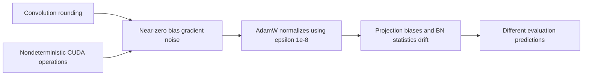

# Diagnosis of the 5,000-update accuracy discrepancies

Recorded 2026-10-12 on `mmcv2`. All edits and progress remain on this
branch; `main`, frozen legacy source, original configs and environments
are unchanged. Failed accuracy runs and their thresholds are preserved.

## Conclusion and limits

There is a confirmed difference in the effective convolution precision of
the two stacks. Modern cuDNN with TF32 allowed produces much larger
numerical gradients for decoder projection biases that are mathematically
redundant before BatchNorm. AdamW's unchanged epsilon, 1e-8, makes this
gradient noise consequential. Biases and BatchNorm statistics drift while
training losses initially remain close.

This is a verified contributing mechanism, not proof that it explains every
final-score difference. Identical-seed legacy CUDA repeats also diverge,
and full-precision modern convolutions do not restore every parameter or
statistic after 700 updates. Full accuracy parity is still unestablished.
No loss, LR, optimizer epsilon, target threshold or dataset was retuned.

## What was ruled out

- The complete 80,640,000-element seed-0 shuffle and its resulting CPU RNG
  state match exactly across Torch 1.7.1 and 2.1.0. Earlier shuffle tests
  had only covered lengths 10, 127 and 1,000.
- Model construction/initialization leaves identical CPU RNG states in
  both directions. The actual native checkpoint's epoch-start CPU RNG
  matches that initialized-model state. Earlier qualification also checked
  all 2,143 initial tensors and 2,134 optimizer groups.
- The first 700 real CT -> MR batches match byte for byte, with canonical
  filenames. Python, NumPy, CPU Torch and CUDA Philox seed/offset signatures
  match after every update, including the validation at 500. The FP32
  convolution control retains those same batches and RNG signatures.
- The MR -> CT first-update controls likewise use identical batches and
  RNG signatures.
- The LR schedule, 50,000 horizon, 5,000 cap, data/prototype assets and
  existing medical metric checks remain unchanged. Divergence grows around
  650-950 updates, before target losses activate at update 2,001.
- The completed modern CT -> MR final checkpoint scores 0.6251677787 under
  frozen legacy inference and 0.6251673327 under modern inference: an
  absolute difference of 4.46e-7. Source mDice differs by 3.93e-6. Returning
  to the legacy evaluator does not recover the legacy-trained 0.6857276685.
  The major CT discrepancy lies in the learned model, not metric reporting.

The 700-update controls do not prove identical stochastic behavior over all
5,000 updates. Their scope and the separate MR first-update check are
explicit; no claim of a complete 5,000-update batch/RNG audit is made.

## Convolution precision and gradient amplification

Both original stacks declare FP32 storage and allow cuDNN/matmul TF32.
That permission does not force identical arithmetic across CUDA/cuDNN
versions. The old stack uses CUDA 11.0/cuDNN 8.0.5; the modern stack uses
CUDA 11.8/cuDNN 8.7.0 on the same GPU. PyTorch documents that TF32 uses
reduced input precision for eligible operations and that results can vary
across releases and kernels. See the
[numerical accuracy notes](https://docs.pytorch.org/docs/main/notes/numerical_accuracy.html)
and the versioned
[Torch 2.1 reproducibility notes](https://github.com/pytorch/pytorch/blob/v2.1.0/docs/source/notes/randomness.rst).

The head's linear projections feed a 1x1 convolution and BatchNorm.
A constant projection bias shifts each fused channel by a constant;
training BatchNorm subtracts that channel mean. In exact arithmetic, this
path has zero gradient for the projection bias. Finite arithmetic leaves
a residual, whose scale matters to AdamW.

Measured first-update gradient RMS for
`model.decode_head.linear_c.0.proj.bias`:

| Direction | Legacy, TF32 allowed | Modern, TF32 allowed | Modern, cuDNN TF32 disabled |
| --- | --- | --- | --- |
| CT -> MR | 2.1193e-9 | 1.4506e-7 | 6.8231e-10 |
| MR -> CT | 1.6780e-9 | 6.6168e-8 | 5.6460e-10 |

In the modern default, 95.4% / 88.5% of those bias coordinates have
gradient magnitude above the optimizer's 1e-8 epsilon. In the legacy and
FP32-convolution controls, none do. Disabling only cuDNN TF32 reduces this
gradient RMS by approximately 212x / 117x while keeping matmul TF32,
all batch/RNG signatures and all configuration hyperparameters unchanged.
This intervention is explicitly a diagnostic precision override.



At update 500, compared with the traced legacy model, the modern default's
maximum first-projection bias difference is 0.005133; the FP32 convolution
control reduces it to 0.001715. Maximum decoder BatchNorm running-mean
difference falls from 0.382140 to 0.018989. These differences accumulate
despite small early mean-loss differences. The larger score differences
precede self-training; subsequent pseudo-label feedback can plausibly
amplify them, but its contribution has not been isolated by these controls.

## Legacy variability and residual differences

Two legacy 700-update runs use identical batch hashes and all RNG
signatures, yet floating state diverges. At 700, classifier-weight RMS
difference between legacy repeats is 8.7940e-5. Legacy vs modern default
is 9.4574e-5; legacy vs modern FP32 convolutions is 8.8594e-5.
BatchNorm running-mean RMS differences are respectively 0.04508,
0.05679 and 0.04269.

Thus full-precision convolutions suppress the demonstrated gradient
problem, but they do not produce identical long trajectories. A smaller
early bias/BN error cannot be presented as a completed accuracy fix.
The original benchmark-enabled, nondeterministic CUDA policy is itself
sensitive to numerical perturbations. These short controls do not measure
the distribution of final/best 5,000-update mDice.

Torch AdamW also changes the first-moment implementation from separate
multiply/add operations to `lerp_`; compare
[Torch 1.7.1](https://github.com/pytorch/pytorch/blob/v1.7.1/torch/optim/adamw.py)
and [Torch 2.1.0](https://github.com/pytorch/pytorch/blob/v2.1.0/torch/optim/adamw.py).
An identical-gradient 700-step CPU control shows a maximum parameter
difference of about 1.19e-7. This confirms another rounding source;
it does not establish that optimizer arithmetic alone causes the observed
accuracy gaps or bound its effect under neural-network feedback.

## Alternative paths checked

Switching modern convolutions to the older cuDNN API did not restore the
legacy gradient scale: TF32-allowed bias gradient RMS remains 1.3328e-7.
That diagnostic initially hit the previously observed missing
`libnvrtc.so` name. Workspace-only symlinks to the Torch wheel's existing
NVRTC libraries enabled the test; installed environment files/packages
were not modified. Neither the older API nor that library-name repair
is a demonstrated solution to the precision discrepancy.

Legacy JSON logging also substitutes the validation split size for the
iteration number during validation and rounds tiny learning rates to
zero. The trajectory analysis reconstructs the 500-update validation
sequence from record order; those display issues do not establish an LR
or stopping defect. All runs retain the correct final counters/LRs.

## Evidence and reproduction

Evidence directory: `work_dirs/migration_baseline/step9_diagnosis_20261012/`.

- `training_trajectories.json`, `.png` and `.pdf`: source losses and target
  validation curves for both original legacy/modern runs.
- `{legacy,modern}_sampler.json`: full permutation and RNG hashes;
  initialization files and actual epoch RNG snapshots: startup controls.
- `legacy_runtime_c/`, `modern_runtime_a/`, `legacy_runtime_repeat/`,
  `modern_cudnn_tf32_off_700/`: real-data 700-update traces and selected
  student/teacher/gradient/optimizer/BN snapshots.
- `real_batch_rng_comparison.json`, `precision_long_trace_comparison.json`
  and `legacy_repeat_variability.json`: comparisons through validation.
- `both_direction_gradient_precision.json`,
  `mr2ct_precision_comparison.json`, `projection_bias_precision.png/.pdf`:
  first-update precision controls in both directions.
- `modern_checkpoint_legacy_inference_comparison.json`: same modern CT
  checkpoint evaluated in the frozen legacy stack.
- API instrumentation attempts that failed before an update and the failed
  v7 library-loading attempt are retained; they are not training references.

`tools/diagnose_mmcv2_discrepancies.py` uses frozen source under `epa` and
the current port under `epa-mmcv2`. Example diagnostic commands, using
fresh tags and host GPU access, are:

```bash
/home/akash/miniconda3/envs/epa/bin/python -u \
  tools/diagnose_mmcv2_discrepancies.py --stack legacy --mode runtime \
  --tag FRESH_LEGACY_TAG --updates 700
/home/akash/miniconda3/envs/epa-mmcv2/bin/python -u \
  tools/diagnose_mmcv2_discrepancies.py --stack modern --mode runtime \
  --tag FRESH_MODERN_TAG --updates 700
/home/akash/miniconda3/envs/epa-mmcv2/bin/python -u \
  tools/diagnose_mmcv2_discrepancies.py --stack modern --mode runtime \
  --tag FRESH_FP32_TAG --updates 700 --cudnn-tf32 off
```

These shorter runs retain the 50,000 schedule and original validation
interval, with separate diagnostic stopping points. Native training also
validates at its cap; snapshots at 700 precede that extra final validation.
Diagnostic validation scores are not substituted into the 5,000-update
accuracy comparison.

## Next validation

1. Freeze an explicit candidate precision policy: FP32 convolutions,
   matmul TF32 retained, benchmark/nondeterminism unchanged. Treat this as
   a documented compatibility experiment, not the already-qualified
   default or a silent change to the original precision contract.
2. Recheck the candidate against the existing immutable numerical budget,
   including near-zero decoder gradients and behavior through validation.
3. Use fresh 5,000-update runs from the original weights, retaining the
   50,000 horizon, to measure candidate final/best accuracy in both
   directions. Preserve all existing failed runs and their provenance.
4. Measure complete-run legacy/modern repeat variability, using matched
   additional seeds if needed. Record the expanded run plan before launch.
   Do not dismiss the current failures as randomness without that evidence.
5. Keep target mDice <=0.01 absolute difference and per-class >0.02
   investigation rules unchanged. Review source/ASSD regressions as well.
   Only completed accuracy evidence can establish migration success.

The production precision hook and original configs were not changed by
the diagnosis. Subsequently, the user authorized the FP32-convolution
candidate described in `MIGRATION_PRECISION_EXPERIMENT.md`. Its training
and evaluation policy disables cuDNN TF32; matmul TF32 and the original
benchmark/nondeterminism policy remain unchanged. Qualification and fresh
5,000-update runs must establish its accuracy. The migration remains
incomplete.
