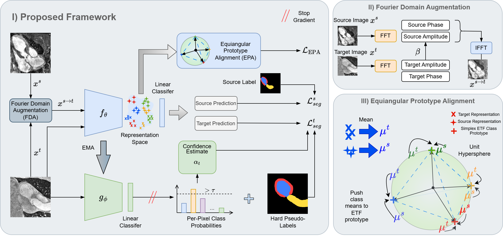

# Equiangular Prototype Alignment for Unsupervised Domain-Adaptive Medical Image Segmentation

Official implementation of **Equiangular Prototype Alignment for Unsupervised
Domain-Adaptive Medical Image Segmentation**, accepted at **ICIP 2026**.

**Authors:** Akash Sharma, Arunima Sarkar, Mohanasankar Sivaprakasam

[Paper](https://ieeexplore.ieee.org/document/11630366/) ·
[Weights & dataset](https://drive.google.com/drive/folders/1BcGtDlH80o15i-A_VTL-P6UPHNJnaI5D?usp=sharing) ·
[Paper source](https://github.com/akashrma/epa-camera-ready)



**EPA overview.** Fourier domain augmentation aligns image appearance,
mean-teacher self-training provides target supervision, and equiangular
prototype alignment maps class representations to fixed simplex ETF anchors.

Train EPA for CT → MR and MR → CT segmentation using the local SegFormer/MiT-B5
implementation, fixed ETF prototypes, FDA and self-training. The current code
runs on **Python 3.11, PyTorch 2.1, MMCV 2.1 and MMEngine**. Existing medical
experiment configs are translated to MMEngine by the training entrypoint.

This README covers installation, data preparation, reproducing the paper
results with the released EPA weights, new training runs and resume.
Upstream attribution and licensing are in [LICENSES.md](LICENSES.md).

[Setup](#1-install-the-environment) ·
[Data](#2-prepare-data-and-initialization-weights) ·
[Paper results](#3-reproduce-the-paper-results) ·
[Training](#4-start-a-new-training-run) ·
[Resume](#5-resume-or-initialize-from-a-checkpoint)

## 1. Install the environment

The tested platform is Linux with one NVIDIA GPU (RTX 4080 Laptop GPU,
about 12 GiB VRAM), Python 3.11.17, PyTorch 2.1.0+cu118, torchvision
0.16.0+cu118, MMCV 2.1.0 and MMEngine 0.10.7. A compatible NVIDIA driver is
required. Use the pinned dependencies below for reproducible experiments.

| Component | Version |
| --- | --- |
| Python | 3.11.17 |
| PyTorch / torchvision | 2.1.0+cu118 / 0.16.0+cu118 |
| CUDA runtime / cuDNN | 11.8 / 8.7.0 |
| MMCV / MMEngine | 2.1.0 / 0.10.7 |
| NumPy / SciPy | 1.26.4 / 1.11.4 |
| timm / Kornia | 0.4.12 / 0.5.8 |
| MedPy / SimpleITK | 0.5.2 / 2.3.1 |
| OpenCV | 4.8.1.78 |

```bash
git clone https://github.com/akashrma/epa-medical-uda.git
cd epa-medical-uda
conda create --name epa-medical --override-channels --channel conda-forge python=3.11.17 pip --no-default-packages --yes
conda activate epa-medical
python -m pip install pip==25.1.1 setuptools==75.1.0 wheel==0.44.0 packaging==24.1
python -m pip install numpy==1.26.4 torch==2.1.0+cu118 torchvision==0.16.0+cu118 --extra-index-url https://download.pytorch.org/whl/cu118
python -m pip install -r requirements.lock.txt --only-binary=mmcv
python -m pip check
```

The lock includes medical metrics and compiled MMCV operations. Run commands
from this repository root so Python uses the local `mmseg` package. Keep
`mmcv-full`, `mmcv-lite` and upstream `mmsegmentation` out of this environment.
`requirements.txt` lists direct dependencies. `requirements.lock.txt` pins
the complete Python environment.
The runtime enforces the exact MMCV and MMEngine versions. The lock pins
all 78 Python distributions, including packaging tools; it does not pin the
host driver or conda base packages.

Check local package resolution, CUDA forward/backward and a compiled
operation before training. This needs no dataset or model weights:

```bash
python - <<'PY'
from pathlib import Path

import mmcv
import mmengine
import torch
from mmcv.ops import nms

import mmseg

assert mmcv.__version__ == '2.1.0'
assert mmengine.__version__ == '0.10.7'
assert torch.__version__ == '2.1.0+cu118'
assert Path(mmseg.__file__).resolve() == Path('mmseg/__init__.py').resolve()
assert torch.cuda.is_available(), 'A visible NVIDIA GPU is required'
x = torch.randn(1, 3, 16, 16, device='cuda', requires_grad=True)
conv = torch.nn.Conv2d(3, 4, 3).cuda()
conv(x).square().mean().backward()
assert torch.isfinite(x.grad).all()
boxes = torch.tensor([[0., 0., 10., 10.]], device='cuda')
_, keep = nms(boxes, torch.tensor([.9], device='cuda'), .5)
assert keep.tolist() == [0]
print('Local package:', mmseg.__file__)
print('GPU:', torch.cuda.get_device_name(0))
PY
```

## 2. Prepare data and initialization weights

Download the prepared dataset and pretrained models from the
[project download folder](https://drive.google.com/drive/folders/1BcGtDlH80o15i-A_VTL-P6UPHNJnaI5D?usp=sharing).
Extract the prepared data and place the three downloaded weights under
`pretrained/`: `mit_b5_mmseg.pth` for training initialization, and
`CT2MR_best_mDice.pth` / `MR2CT_best_mDice.pth` for the paper results.
Dataset arrays and large checkpoints are downloaded separately from Git.

```text
epa-medical-uda/
├── data/
│   ├── data_np/
│   │   ├── train_ct/       # ct_train_slice0.npy, ...
│   │   ├── gt_train_ct/    # ct_train_slice0_gt.npy, ...
│   │   ├── train_mr/       # mr_train_slice0.npy, ...
│   │   ├── gt_train_mr/    # mr_train_slice0_gt.npy, ...
│   │   ├── val_ct/         # ct_val_slice0.npy, ...
│   │   ├── gt_val_ct/      # ct_val_slice0_gt.npy, ...
│   │   ├── val_mr/         # mr_val_slice0.npy, ...
│   │   ├── gt_val_mr/      # mr_val_slice0_gt.npy, ...
│   │   ├── test_ct/        # supplied CT .nii.gz.npz volumes
│   │   └── test_mr/        # supplied MR .nii.gz.npz volumes
│   └── datalist/          # generated below
├── pretrained/
│   ├── mit_b5_mmseg.pth
│   ├── CT2MR_best_mDice.pth
│   └── MR2CT_best_mDice.pth
└── etf_prototypes/
    ├── etf_prototypes_K5_D768.pt
    ├── etf_prototypes_K5_D768.npy
    └── etf_prototypes_K5_D768.json
```

The ETF assets are already tracked in Git. Preserve them for reproduction:
missing prototypes are generated automatically, which changes initialization
and consumes RNG state. An `.npy` prototype alone does not replace the `.pt`
and metadata files used by the loader.

Images are prepared single-channel NumPy slices with the configured `[-1, 1]`
input scale; the loader expands them to three channels and applies the
existing BGR normalization. Masks contain integer class IDs:

| ID | Class |
| --- | --- |
| 0 | background |
| 1 | Myo |
| 2 | LAC |
| 3 | LVC |
| 4 | AA |

Use the supplied preprocessing and splits to compare results. This repository
does not provide a raw NIfTI-to-training-slice preprocessing recipe.

### Generate the ordered datalists

```bash
python tools/prepare_medical_datalists.py --include-test
python tools/prepare_medical_datalists.py --include-test --check
```

The generator checks that every required array exists and writes eight
train/validation lists plus `test_ct.txt` and `test_mr.txt` under
`data/datalist/`. Omit `--include-test` if only preparing training slices.
The generator preserves existing matching lists and refuses to overwrite
different lists. Paths are relative to each list file, for example:

```text
# train_ct.txt (one path per line; omit this comment in the actual list)
../data_np/train_ct/ct_train_slice0.npy
../data_np/train_ct/ct_train_slice1.npy
```

Image and mask lists have the same length and matching row order. The
recorded splits are:

| Modality | Training slices | Validation slices |
| --- | --- | --- |
| CT | 8,400 | 1,200 |
| MR | 9,600 | 2,400 |

The selected pipelines load target training masks, but `UDADataset` passes
only target images/metadata to UDA; target ground truth is not used by the
training loss. The supplied mask lists are still required by these configs.
The paper checkpoint protocols use MR validation slices for CT → MR and
CT test volumes for MR → CT, as described below.

Check the initialization assets and generated lists against the recorded
SHA-256 hashes:

```bash
sha256sum -c resources/reproduction_assets.sha256
```

The expected list hashes assume the default layout shown above.

## 3. Reproduce the paper results

Use the released EPA weights from the project download folder. Verify the
checkpoint files and CT test list before evaluation:

```bash
sha256sum -c resources/paper_checkpoints.sha256
```

### Reference results from the paper

| Direction | Released checkpoint | Evaluation data | Mean Dice (%) |
| --- | --- | --- | --- |
| CT → MR | `CT2MR_best_mDice.pth` | MR validation slices | 71.2 |
| MR → CT | `MR2CT_best_mDice.pth` | CT test volumes | 85.2 |

Mean Dice averages the four foreground structures (Myo, LAC, LVC, AA),
excluding background. The table uses the paper's rounding; metric JSON files
retain the unrounded 0–1 scores. Use the supplied weights and the exact
protocol below to reproduce these numbers. Fresh training runs can produce
different checkpoints and scores.

### CT → MR: MR validation slices

```bash
python tools/test.py configs/medical/ct2mr_epa_segformer_mitb5_eval.py \
  pretrained/CT2MR_best_mDice.pth --eval mDice \
  --metrics-out work_dirs/paper_evaluation/ct2mr_metrics.json
```

This evaluates all 2,400 images/masks from `val_mr.txt` / `val_mr_gt.txt`
using the configured NumPy slice preprocessing. Dice is aggregated across
validation slices before averaging the foreground classes.

### MR → CT: CT test volumes

```bash
python tools/test.py configs/medical/mr2ct_epa_segformer_mitb5_eval.py \
  pretrained/MR2CT_best_mDice.pth --eval mDice \
  --metrics-out work_dirs/paper_evaluation/mr2ct_metrics.json
```

This uses `test_ct.txt` with the four supplied volumes:
`image_ct_1003.nii.gz.npz`, `image_ct_1008.nii.gz.npz`,
`image_ct_1014.nii.gz.npz` and `image_ct_1019.nii.gz.npz`.
Each contains `arr_0` (image) and `arr_1` (mask). Inference slices along
axis 2, applies CT normalization and flips axes 0 and 1, then reconstructs
each volume. Dice is computed per volume and class, then averaged across
volumes and the four foreground classes. The evaluation config preserves
this complete protocol, including orientation and normalization.

The ordinary MR → CT training config evaluates CT validation slices. Use
`mr2ct_epa_segformer_mitb5_eval.py` with the released checkpoint for the
paper's volume-level result.

### Evaluation options

Both commands use whole-image FP32 inference, batch size 1 and four workers.
Keep the supplied data, preprocessing, orientation and checkpoint unchanged.
Do not enable augmentation or slide inference for the reported results.
Add `--out FILE.pkl` to retain predictions.

The slice evaluator also reports ASSD. For volume ASSD, use
`--eval mDice mASSD`. ASSD averages the two directional surface-distance
means with equal weight and uses the existing 1.0 fallback for empty/invalid
masks. Volume Dice uses zero when both masks are empty.

For a newly trained checkpoint, evaluate validation slices with the same
training config, for example:

```bash
python tools/test.py CONFIG CHECKPOINT --eval mDice --metrics-out METRICS.json
```

## 4. Start a new training run

The EPA/FDA training configs use batch size 4, four workers, 256×256 crops,
FDA L=0.01 and a 50,000-update LR/UDA horizon. Training uses FP32, convolution
TF32 disabled, matmul TF32 enabled and cuDNN benchmark enabled.

Train CT → MR from the MiT-B5 initialization:

```bash
python tools/train.py configs/medical/ct2mr_selftrain_nomix_etf_tgt_dicece_segformer_mitb5_fda.py \
  --work-dir work_dirs/ct2mr_epa_fda_seed0 --seed 0
```

Train MR → CT:

```bash
python tools/train.py configs/medical/mr2ct_selftrain_nomix_etf_tgt_dicece_segformer_mitb5_fda.py \
  --work-dir work_dirs/mr2ct_epa_fda_seed0 --seed 0
```

Run the directions sequentially on one GPU with fresh work directories.
Change `--seed` and the work directory for a new seeded experiment. Add
`--dry-run` to inspect resolved settings without building a model or using
the GPU.

Training uses `runner.max_iters` by default. Set `--stop-after N` for a
shorter run; `N` must be positive and no larger than `runner.max_iters`.
The stop cap never changes the LR/UDA schedule horizon. Validation runs
every 500 updates and selects the strictly highest target foreground mDice.
Runs save `experiment_spec.py`, `native_config.py`, `launch_manifest.json`,
a source archive, logs, TensorBoard output, best weights and full iteration
checkpoints. The default periodic full-checkpoint interval is 50,000, and a
full checkpoint is also saved at an explicit stop cap.

Use a child config for a new experiment, preserving the original reference:

```python
# Save as configs/medical/ct2mr_epa_fda_custom.py.
_base_ = ['./ct2mr_selftrain_nomix_etf_tgt_dicece_segformer_mitb5_fda.py']
seed = 1
optimizer = dict(lr=6e-5)
```

Launch it with `python tools/train.py CONFIG --work-dir FRESH_WORK_DIR`.
`--cfg-options KEY=VALUE` supports overrides, for example
`--cfg-options checkpoint_config.interval=1000` to retain periodic full
checkpoints for recovery. The default `max_keep_ckpts=1` retains one periodic
checkpoint; choose a larger value if needed. Best weights are separate.

For a different dataset, supply paired image/mask lists with the same class
mapping and override `data.train.source`, `data.train.target`, `data.val`
and `data.test` in a child config. The datalist generator is specifically for
the supplied slice names/counts. Changes to data, batch size, crops, loss,
optimizer or horizon define a new experiment and require validation.

`run_experiments.py --config CONFIG` remains available as a wrapper; it writes
child configs under `configs/generated/` and results under `work_dirs/`.
For a two-update CLI smoke run in a separate output directory:

```bash
python run_experiments.py --config configs/medical/ct2mr_selftrain_nomix_etf_tgt_dicece_segformer_mitb5_fda.py \
  --work-dir work_dirs/ct2mr_startup_smoke --startup-test
```

Single-GPU EPA/FDA with the two configs above is the tested training path.
MIC, dynamic prototypes and other architecture/config variants are research
options. AMP and distributed UDA are unsupported. Configuration validation
rejects unsupported runtime settings.

## 5. Resume or initialize from a checkpoint

Resume from a **full native iteration checkpoint**, retaining the original
config, seed, horizon, precision and data/sampling settings:

```bash
python tools/train.py configs/medical/ct2mr_selftrain_nomix_etf_tgt_dicece_segformer_mitb5_fda.py \
  --work-dir work_dirs/ct2mr_partial --seed 0 --stop-after 1000
python tools/train.py configs/medical/ct2mr_selftrain_nomix_etf_tgt_dicece_segformer_mitb5_fda.py \
  --work-dir work_dirs/ct2mr_partial --seed 0 \
  --resume-from work_dirs/ct2mr_partial/iter_1000.pth
```

`--resume` without a path discovers the last full checkpoint in the work
directory. Native resume restores optimizer/scheduler, teacher/prototypes,
UDA counters, RNG and data-stream state. Floating continuation can differ
under nondeterministic CUDA execution.

| Checkpoint | Evaluation / `--load-from` | Full native resume |
| --- | --- | --- |
| Released paper weights, matching architecture | Strict student load | Unsupported |
| Native best weights | Strict student load | Unsupported: optimizer/scheduler absent |
| Native full iteration checkpoint | Strict student load | Supported with matching runtime/data contract |

Loading strips an anchored `module.` prefix and selects `model.` student
keys from UDA checkpoints; every student key and tensor shape must match.
`--load-from CHECKPOINT` starts fresh optimization, UDA and sampling state.
GPU count, horizon, precision and data/sampling settings must match for
resume. Data replay restores sample order and random state; nondeterministic
CUDA execution can still change floating continuation. A shorter diagnostic stop can save a full resume checkpoint
without changing the schedule horizon.

## Repository layout

| Path | Purpose |
| --- | --- |
| `mmseg/` | Local segmentation, EPA/UDA, data and MMEngine implementation |
| `configs/_base_/` | Models, datasets, optimizer, schedule and UDA bases |
| `configs/medical/` | Direction/method experiment configs |
| `etf_prototypes/` | Fixed prototype tensors and metadata, tracked in Git |
| `tools/` | Training, evaluation, datalist preparation and analysis |
| `data/`, `pretrained/` | Local dataset and downloaded weights |
| `configs/generated/`, `work_dirs/` | Generated configs and run artifacts |

Back up checkpoints, resolved configs, manifests, logs and metrics separately;
run artifacts are ignored by Git.
